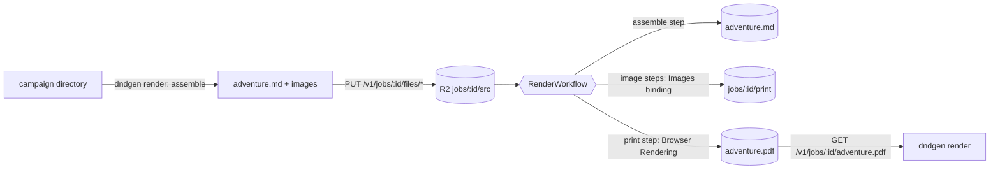

# Architecture

dndgen turns a campaign written with the lorewright skill into a PDF that looks like a
published adventure. It does that in two stages:

1. **Assemble**: the campaign's files become one [Adventure Markdown](adventure-markdown.md)
   document (ADR [01](adr/01-assemble-campaigns-into-one-adventure-markdown-file.md)).
2. **Print**: the document becomes print HTML, which Chrome on Cloudflare Browser Rendering
   prints to PDF (ADR [02](adr/02-print-with-cloudflare-browser-rendering.md)).

## Packages

npm workspaces, TypeScript run without a build step (Node strips the types; wrangler bundles
the Worker).

| Package | Runs on | What it does |
|---|---|---|
| `packages/core` (`@dndgen/core`) | anywhere | `assemble()`, `renderHtml()`, page sheets, outline matching; the `dndbeyond` theme in `assets/themes/`. No Node or Workers APIs |
| `packages/worker` (`@dndgen/worker`) | Cloudflare Workers | HTTP API (Hono), the render Workflow, Browser Rendering, PDF post-processing (pdf-lib) |
| `packages/cli` (`@dndgen/cli`) | Node | The `dndgen` command: assemble and preview offline, render through a Worker |

`scripts/vendor.ts` copies mermaid into `packages/core/assets/vendor/` (run by the Worker's
build and on demand); `scripts/doc.ts` writes `docs/generated/`.

## Data flow

The CLI assembles locally and uploads only the Adventure Markdown and the pictures it uses,
one file per request, so the Worker never holds a whole campaign in memory. The Worker also
accepts an uploaded campaign directory and assembles it itself.

### The render workflow

`RenderWorkflow` (Cloudflare Workflows) runs one job in retried steps:

1. **assemble**: lists `jobs/<id>/src/`, assembles a campaign or takes `adventure.md`, and
   stores `jobs/<id>/adventure.md`.
2. **image `<path>`** (one step per picture): scales it to at most 1800 px with the Images
   binding into `jobs/<id>/print/`; on failure the original is used and a warning recorded.
3. **print**: one Browser Rendering session.
   - The page lives on a fake origin (`https://dndgen.invalid`); request interception
     answers every request from the theme assets (the `ASSETS` binding) and the job's files
     in R2, and blocks everything else.
   - **Pass 1** prints the book; the PDF's bookmarks, read with pdf-lib, give the page of
     every heading (`matchOutline`).
   - **Pass 2** prints it again with those numbers in the table of contents (their width
     is fixed, so the layout does not move; a third pass runs if it did).
   - The **page sheets** are printed: one background sheet with the parchment and one sheet
     per page with its running footer. pdf-lib lays them under the book's pages
     (ADR [03](adr/03-draw-page-decoration-as-sheets-under-the-pages.md)), sets the
     document information and saves `jobs/<id>/adventure.pdf` and `report.json`.

Job status is the Workflow instance's status; the job id is the instance id.

## Printing in a browser

`dndgen preview` writes the same HTML with `decoration: "css"`: the parchment and running
footers come from `browser-print.css` (`@page` backgrounds and page-margin boxes). Chrome
131 or later prints it as the finished book, without page numbers in the contents.

## Theme

`packages/core/assets/themes/dndbeyond/` holds `theme.css`, `browser-print.css`, the fonts
and the frame images, ported from the Homebrewery's 5ePHB theme. A theme is a directory with
those two stylesheets; `theme:` in the front matter picks it.
